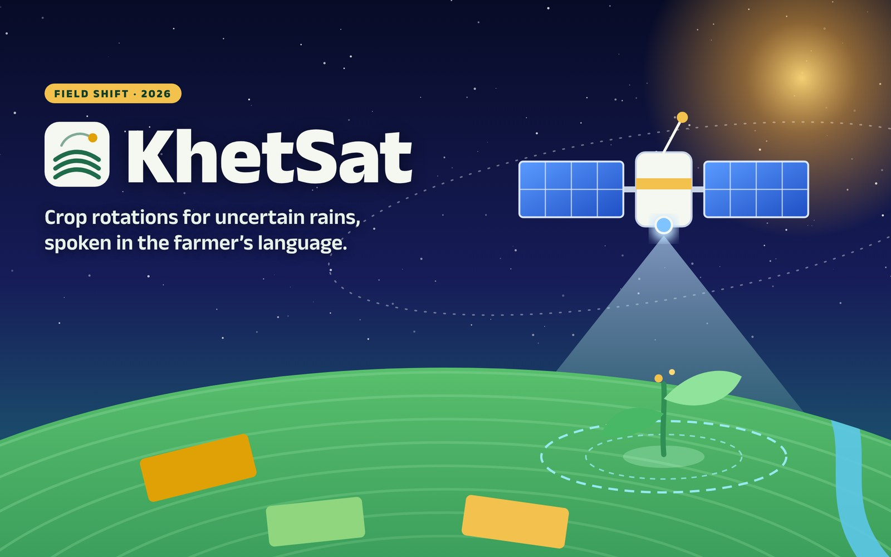
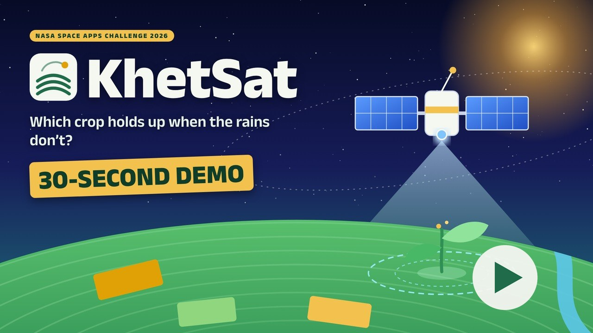
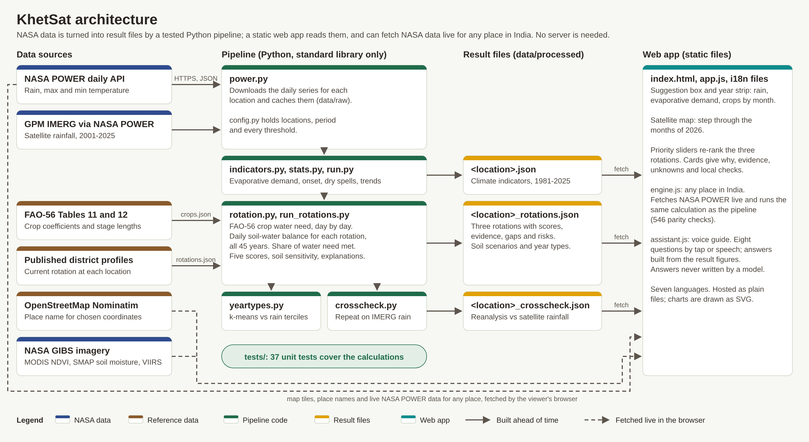

<p align="center">
  <a href="https://demonjd2026-afk.github.io/khetsat/"></a>
</p>

<h1 align="center">KhetSat</h1>

<p align="center"><strong>Crop rotations for uncertain rains, spoken in the farmer's language.</strong><br>
A free web app that replays crop rotations through 45 years of NASA weather data and tells a farmer, in plain words and by voice, which one holds up when the rains are poor.</p>

<p align="center">
  <a href="https://demonjd2026-afk.github.io/khetsat/"><strong>Live app</strong></a> ·
  <a href="https://youtu.be/L0wsDUCh27w"><strong>30-second demo</strong></a> ·
  <a href="https://youtu.be/NaSWAxlDzoc"><strong>Full demo</strong></a> ·
  <a href="docs/METHODS.md"><strong>Methods</strong></a> ·
  <a href="#quickstart"><strong>Quickstart</strong></a>
</p>

<p align="center">
  
  
  
  
  <a href="LICENSE"></a>
</p>

Built by [Jayanth Dolai](https://www.linkedin.com/in/jayanth-dolai-7b115213a/) (team **KhetSat**) for the
**2026 NASA Space Apps Challenge**, challenge *Field Shift: Adapting Farms with NASA Data*
(Visakhapatnam local event, 14-15 November 2026).

## Demo videos

| 30-second demo (the NASA submission) | Full demo (4:53) |
|---|---|
| [](https://youtu.be/L0wsDUCh27w) | [](https://youtu.be/NaSWAxlDzoc) |
| **[▶ Watch on YouTube (0:29)](https://youtu.be/L0wsDUCh27w)**: the problem, the app answering a spoken Telugu question, and what comes next. | **[▶ Watch on YouTube (4:53)](https://youtu.be/NaSWAxlDzoc)**: the problem, the suggestion, Telugu and Hindi voice, rotations, rain, the satellite map, accuracy, a live run for a new place, the architecture and the conclusion. |

Both videos show the real web app. The narration and the English, Telugu and Hindi voices in them are AI-generated (Piper open-source text-to-speech).

## Contents

- [Demo videos](#demo-videos)
- [At a glance](#at-a-glance)
- [Architecture](#architecture)
- [Where NASA data is used](#where-nasa-data-is-used)
- [The problem](#the-problem)
- [Results](#results)
- [How it works](#how-it-works)
- [Using the app](#using-the-app)
- [The voice guide and the question router](#the-voice-guide-and-the-question-router)
- [Can you trust the numbers?](#can-you-trust-the-numbers)
- [Quickstart](#quickstart)
- [Tests](#tests)
- [Project layout](#project-layout)
- [Security and privacy](#security-and-privacy)
- [Use of AI](#use-of-ai)
- [What's next](#whats-next)
- [Limitations](#limitations)
- [Licence](#licence)

## At a glance

| | |
|---|---|
| **What it answers** | Which crop rotation holds up at this place when the rains are poor? |
| **Evidence** | Daily NASA POWER weather for 1981 to 2025, run through a day-by-day crop water balance (FAO-56) for the rotation grown today and two alternatives |
| **Result** | For each rotation: why it was suggested, the evidence, the benefits, what is not known, and what to check locally |
| **Where** | Anantapur, Krishna and Anakapalli pre-analysed; any other point in India computed live in the browser |
| **For people who do not read** | The result in everyday words with one "Hear the result" button; eight common questions answered by tap, typing or speech |
| **Languages** | English, Telugu, Hindi, Tamil, Kannada, Marathi, Odia |
| **Self-checks** | 37 unit tests; 546 parity checks between the browser engine and the pipeline; ranking unchanged on GPM IMERG satellite rainfall; failed seasons in Anantapur match reported drought years |
| **Stack** | Python 3.10+ (standard library only) pipeline; plain HTML, CSS and JavaScript app on GitHub Pages; Leaflet map; browser speech; optional Cloudflare Worker |

## Architecture



Left to right: NASA and reference data go into a Python pipeline that writes result files; the static web app reads those files, and for any other place in India it fetches NASA POWER data in the browser and runs the same calculation in `app/engine.js`. No server is needed. Two optional pieces are not drawn: the SoilGrids soil lookup (see [Using the app](#using-the-app)) and the question router (see [The voice guide and the question router](#the-voice-guide-and-the-question-router)). [How it works](#how-it-works) walks the same path stage by stage.

## Where NASA data is used

| Source | Used for |
|---|---|
| NASA POWER daily API (MERRA-2 rainfall and temperature, 1981-2025) | Climate indicators and the rotation water balance |
| GPM IMERG rainfall, served by NASA POWER (2001-2025) | Cross-check of rainfall and of the rotation ranking |
| NASA GIBS: MODIS NDVI, SMAP L4 root-zone soil moisture, VIIRS true colour | Satellite map in the app (display only) |
| ISRIC SoilGrids 2.0 (water content at field capacity and wilting point) | Optional estimate of soil water storage for the chosen place |
| OpenStreetMap Nominatim | Place name shown for chosen coordinates (label only) |
| FAO Irrigation and Drainage Paper 56, Tables 11 and 12 | Crop coefficients and growth-stage lengths |
| Sivakumar (1988) | Definition of monsoon onset |
| KVK Reddipalli district profile; ICAR-CRIDA contingency plan for Krishna | Current rotations |

---

## The problem

A farmer chooses a rotation before knowing what kind of year is coming. In Anantapur, monsoon rainfall averages about 350 mm but has ranged from 144 mm to 611 mm since 1981, and the date the rains settle in moves across three months. Rain you can count on in three years out of four is only 284 mm.

## Results

Every number below comes from the result files committed in [`data/processed/`](data/processed/).

Anantapur, 1981-2025:

| Rotation | Crop water need per year | Share of water need met, normal year | Seasons below 50% |
|---|---|---|---|
| Groundnut every year (current) | 511 mm | 71% | 5 of 45 |
| Groundnut one year, millet the next | 441 mm | 71% groundnut, 76% millet | 5 and 4 of 45 |
| Millet, then chickpea | 685 mm | 67% millet, 53% chickpea | 9 of 45 and 20 of 44 |

- Alternating groundnut with millet needs 14% less water and adds a second crop family.
- Millet followed by chickpea fails often; the tool shows that too.
- In Krishna, after irrigated rice, irrigated maize needs about 406 mm of irrigation a season against about 248 mm for black gram.
- Repeating the analysis on GPM IMERG satellite rainfall (2001-2025) leaves the ranking of rotations unchanged at all three locations.

Results for crops grown on leftover soil moisture in the delta are flagged as unreliable: the model does not yet represent deep delta soils. See [docs/METHODS.md](docs/METHODS.md).

One more finding shaped the app. The challenge asks teams to compare pattern-finding with statistical approaches, so the 45 years were grouped two ways (`pipeline/yeartypes.py`): k-means clusters on five season features, and simple terciles of monsoon rainfall. For rainfed groundnut in Anantapur the rainfall terciles explain more of the year-to-year variation in crop water outcome (0.67) than the clusters do (0.43), so the app describes good and poor years by rainfall terciles. Details are in [docs/METHODS.md](docs/METHODS.md).

## How it works

| Stage | What it does | Why it is built this way |
|---|---|---|
| **Download** (`pipeline/power.py`, `config.py`) | Fetches daily rain and maximum and minimum temperature for each location from the NASA POWER API and caches them in `data/raw/`. | One open, documented source for the whole record; the cache makes re-runs offline and repeatable. |
| **Indicators** (`indicators.py`, `stats.py`, `run.py`) | Computes evaporative demand (Hargreaves), monsoon onset (Sivakumar 1988), dry spells and trends, per year. | Pure functions on plain lists, so each formula is unit-tested without network access. |
| **Rotation engine** (`rotation.py`, `run_rotations.py`) | Tracks one soil-water store day by day for all 45 years. Crop water need is FAO-56 `Kc x ET0`. Each season is scored by the share of water need that was met (WRSI); below 50% counts as a failed season. | A farmer's question is about bad years, so every year is replayed, not an average. |
| **Year types** (`yeartypes.py`) | Groups years by k-means clusters and by rainfall terciles, and scores which explains crop outcomes better. | The challenge's comparison of pattern-finding and statistical approaches, answered with data. |
| **Cross-check** (`crosscheck.py`) | Repeats the rotation analysis on GPM IMERG satellite rainfall for 2001 to 2025. | Reanalysis rainfall is modelled; the conclusion should not depend on one rainfall product. |
| **Browser engine** (`app/engine.js`) | The same calculation in JavaScript, fed by a live NASA POWER request for the chosen point. | Any farm in India, with no server to run or pay for. |
| **App** (`index.html`, `app/app.js`, `app/i18n*.js`) | Five tabs, priority sliders, soil choice, charts drawn as SVG, a NASA GIBS map, seven languages. | Plain files with no build step load on a basic phone and can be hosted anywhere. |
| **Voice guide** (`app/assistant.js`, `worker/router.js`) | Answers eight fixed questions aloud from the figures on the page. An optional model only names which question was asked. | The spoken answer can never say something the data does not support. |

## Using the app

The page has five tabs, so a farmer sees one thing at a time:

| Tab | What it holds |
|---|---|
| Suggestion | The result in everyday words, with one large "Hear the result" button |
| Rotations | The priority sliders, the soil choice, the three ranked rotations and the soil what-if table |
| Rain | The year-in-the-field chart, what has changed, and the 45-year record |
| Map | NASA satellite layers by month and year |
| Accuracy | How accurate the data is, and the check against satellite rainfall |

- **Suggestion** opens first. It says which rotation fits best, gives one reason, describes each crop in a dry year without percentages ("gets a little over half the water it needs", "failed about 1 year in 9"), and says when the rains usually settle.
- **Priorities.** Five sliders (water in a normal year, holding up in a poor year, using less water, building the soil, breaking pest cycles) re-rank the rotations.
- **Your soil.** Choosing a soil type, asking for an estimate from the SoilGrids soil map, or typing a known water-storage value re-runs the 45 years with that soil instead of the default 100 mm.
- **What has changed.** The last fifteen years are set against the thirty before: monsoon rain, the date the rains settle, and how often each rotation failed.
- **Your place.** For any other point in India, the farmer picks a point on the map or uses their location and enters what they grow now. The app fetches NASA data for that point and compares their rotation with the two best alternatives it finds.

KhetSat supports decisions. It does not replace a farmer's judgment or the local agriculture officer.

## The voice guide and the question router

The guide answers eight common questions (which rotation fits, what happens in a poor-rain year, how to read the map and the chart, how accurate the data is, what to check locally) by tap, by typing or by speaking, and reads the answer aloud in the chosen language.

- **Answers come from the data.** Each answer is assembled from the figures already on the page and is never written by a language model.
- **The router only names the question.** `worker/router.js` is a Cloudflare Worker that calls a Claude model to decide which of the eight questions a free-form question matches, or none. The model returns one word. It never sees the data.
- **It is optional.** The live app uses it (its address is in `app/config.js`). If it is unreachable or the address is removed, the app falls back to keyword matching. When the router has understood a question, the chat says so under the answer.
- **Measured.** On 120 natural phrasings in English, Telugu and Hindi that were not used to build the keyword lists, keyword matching routed 53% to the right question and the router 97% (116 of 120). All 12 out-of-scope questions were declined in both modes. The phrasings were written by the author, not collected from farmers (`node tests/assistant_eval.js`).
- **Device limits.** Reading aloud and voice input use the browser's own speech features. A device without a voice for a language shows the answer as text and says so. Voice input needs Chrome, Edge or Safari and an internet connection.

Setup steps for the router are in [worker/README.md](worker/README.md).

## Can you trust the numbers?

| Check | Result |
|---|---|
| Failed seasons against drought records | The five seasons the model marks as failed for groundnut every year in Anantapur (2002, 2003, 2016, 2018, 2023) are all reported drought years. The check runs one way: milder declared droughts, such as 2011 to 2015, show as below-normal seasons, not failures. |
| A second rainfall product | Repeating the analysis on GPM IMERG rainfall (2001-2025) leaves the ranking of rotations unchanged at all three locations. |
| Rain-gauge normals | NASA POWER rainfall in Anantapur is roughly 9% to 14% above published rain-gauge normals. |
| Formulas | 37 unit tests; the radiation formula is checked against a worked example in FAO-56. |
| Browser engine | 546 values compared with the Python pipeline, all in agreement. |
| Soil | The four soil-type values were checked against FAO-56 Table 19. Every result is also re-run at four storage values to show how much soil matters. |
| Translations | Each of the six Indian-language versions was read against the English by a separate AI reviewer and 146 corrections were applied. No native speaker has reviewed them yet; the app says so in each of them. |

Sources, formulas and the verification status of each item are in [docs/METHODS.md](docs/METHODS.md).

## Quickstart

Python 3.10 or later, standard library only. Node.js is needed only for the JavaScript checks.

```
git clone https://github.com/demonjd2026-afk/khetsat.git
cd khetsat
python3 -m http.server 8000        # then open http://localhost:8000
```

The app is plain HTML, CSS and JavaScript with no build step, and the result files are committed, so it runs as cloned.

To rebuild the results from NASA data:

```
python3 -m pipeline.run            # downloads to data/raw (cached), writes climate indicators
python3 -m pipeline.run_rotations  # rotation comparison
python3 -m pipeline.crosscheck     # satellite rainfall cross-check
```

Results are written to `data/processed/`.

## Tests

```
python3 -m unittest discover -s tests   # 37 unit tests for the calculations
node tests/engine_parity.js             # browser engine against the pipeline (546 values; run the pipeline first)
node tests/i18n_check.js                # every language has every string and placeholder
node tests/assistant_check.js           # voice guide: questions recognised, answers complete (634 checks)
node tests/assistant_eval.js            # voice guide: share of natural phrasings understood
```

## Project layout

| Path | Contents |
|---|---|
| `pipeline/` | Data download, indicators, rotation engine, year types, cross-check |
| `tests/` | Unit tests for the pipeline, and the checks for the in-browser engine, the text and the voice guide |
| `data/reference/` | Crop table and candidate rotations, with their sources |
| `data/processed/` | Result files read by the app |
| `app/`, `index.html` | The web app; `app/engine.js` is the in-browser engine, `app/assistant.js` the voice guide, `app/i18n*.js` the text in seven languages, `app/config.js` the question router's address |
| `worker/` | Optional question router (Cloudflare Worker) for the voice guide |
| `docs/` | Methods, the architecture diagram, and the README images (`docs/img/`) |

## Security and privacy

- The app has no accounts and no server of its own. It is static files on GitHub Pages.
- The router's API key lives only as a Cloudflare Worker secret (`KHETSAT_API_KEY`). It is not in this repository or in the web page.
- The router accepts requests only from the live site and from `localhost:8000`, cuts questions to 300 characters, and lets the model reply with one word only.
- When the router is used, the question text is sent to Anthropic's API. Nothing else about the user is sent.
- For "Your place", the chosen coordinates are sent to NASA POWER, to SoilGrids if a soil estimate is requested, and to OpenStreetMap Nominatim for the place name.

## Use of AI

- **In the app:** the optional question router calls a Claude model to decide which of the eight listed questions a free-form question matches. It never sees the data and never writes an answer.
- **In building it:** Claude (Anthropic) was used as a coding and drafting assistant for the code and documentation, and to draft and machine-review the translations.
- **In the demo videos:** the voices are AI-generated (Piper text-to-speech).
- The crop and water calculations use no AI. They are the published formulas listed in [docs/METHODS.md](docs/METHODS.md).

## What's next

- Review of the six Indian-language versions by native speakers.
- Testing with farmers, and collecting their own phrasings for the voice guide.
- A statistical comparison with crop-yield and daily rain-gauge records.
- Prices and yields, so a rotation can be judged on income as well as water.
- A model of deep delta soils for crops grown on leftover moisture.

## Limitations

- Figures describe a NASA grid cell about 50 km across, not a field, and one point stands for each district.
- Rainfall is from a reanalysis model. It is cross-checked against GPM IMERG but not yet against India Meteorological Department gauge data.
- Evaporative demand uses the Hargreaves formula (temperature only), which can overestimate in humid conditions.
- The onset rule (Sivakumar 1988) was developed for West Africa and has not been calibrated for Andhra Pradesh.
- Soil water storage defaults to an assumed 100 mm; the SoilGrids estimate is modelled, not measured.
- Results for crops grown on leftover soil moisture in the delta are flagged as unreliable.
- Prices, yields, pests and field soil tests are not counted.
- The translations have not been reviewed by native speakers.

The full list is in [docs/METHODS.md](docs/METHODS.md).

## Licence

MIT
